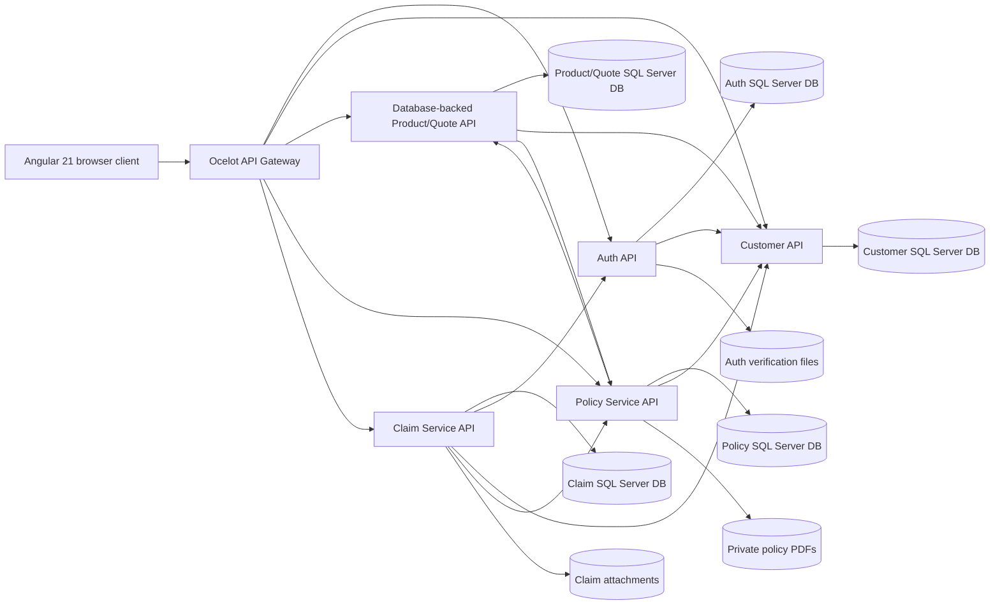
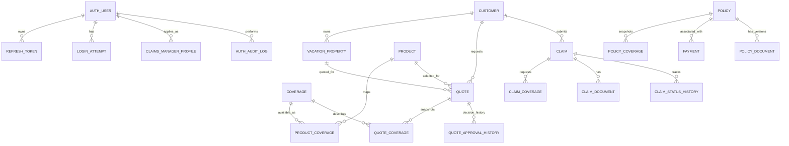

# Software Requirements Specification

## Vacation Home Insurance Management System

| Document field | Value |
|---|---|
| Version | 1.1 |
| Date | 2026-10-22 |
| Status | Implementation-derived baseline; not a statement of independent end-to-end certification |
| Primary source | Current backend and Angular source, tests, and `docs/CONTEXT.md` |

### Document status conventions

- **Implemented (source verified):** behavior is visible in the current source. This does not mean it has passed an end-to-end test.
- **Implemented (focused tests):** a focused test source exists; test execution is reported only where documented in `docs/CONTEXT.md`.
- **Partial / needs verification:** some support exists, but access control, deployment, integration, or end-to-end behavior is incomplete or unverified.
- **Proposed / unresolved:** a recommendation or requirement for future approval, not current system behavior.

## Contents

1. [Introduction](#1-introduction)
2. [Overall Description](#2-overall-description)
3. [System Architecture](#3-system-architecture)
4. [User Roles and Permissions](#4-user-roles-and-permissions)
5. [Functional Requirements](#5-functional-requirements)
6. [Business Rules](#6-business-rules)
7. [Data Requirements](#7-data-requirements)
8. [External Interface Requirements](#8-external-interface-requirements)
9. [Non-Functional Requirements](#9-non-functional-requirements)
10. [Error Handling and Exceptional Scenarios](#10-error-handling-and-exceptional-scenarios)
11. [Deployment and Environment Configuration](#11-deployment-and-environment-configuration)
12. [Testing Requirements](#12-testing-requirements)
13. [Requirements Traceability Matrix](#13-requirements-traceability-matrix)
14. [Known Issues, Gaps, and Future Work](#14-known-issues-gaps-and-future-work)
15. [Appendices](#15-appendices)

## 1. Introduction

### 1.1 Purpose

This SRS describes the implemented system behavior, constraints, interfaces, and known gaps of the Vacation Home Insurance Management System. It gives product owners, developers, testers, reviewers, and maintainers a common baseline for understanding and verifying the current implementation.

### 1.2 Scope

The system provides public product information and authenticated workflows for account management, customer/property records, configurable vacation-home products, quote generation and administrative review, payment, policy issuance and documents, and claims. The system uses an Angular web client, .NET APIs, an Ocelot gateway, and separate SQL Server databases.

The SRS describes source-verified behavior rather than asserting that all features are production-ready, legally valid insurance operations, or independently acceptance-tested. There is no verified external payment processor. Rates and policy wording are academic/example configuration, not market-validated or legally approved insurance terms.

### 1.3 Intended audience

Product/business owners, developers, QA engineers, operations/database administrators, security reviewers, and future maintainers.

### 1.4 Definitions and abbreviations

| Term | Meaning |
|---|---|
| API | Application Programming Interface |
| Admin / Administrator | User with the `Admin` role |
| Claims Manager | User with the `ClaimsManager` role and a reviewed application |
| Customer | User with the `Customer` role |
| EF Core | Entity Framework Core |
| Gateway | Ocelot API Gateway through which the Angular client accesses backend APIs |
| MARS | Multiple Active Result Sets, a SQL Server connection option |
| INR | Indian Rupee |
| Quote snapshot | Persisted values describing the property, pricing, risk, coverage, and decision state at quote time |
| Source verified | Behavior found in source; execution or deployment may still need verification |

### 1.5 References

- `docs/CONTEXT.md` — project handoff, simplified quote workflow, pricing assumptions, verification caveats, known risks.
- `docs/NEXT_STEPS.md` — pending engineering and verification work.
- `docs/SQL_SERVER_MIGRATION_GUIDE.md` — verified connection-string names, database layout, startup initializers, and migration risks.
- `VacationHomeInsurance/VacationHomeInsurance.slnx` — solution project membership.
- `VacationHomeInsuranceUI/src/app/app.routes.ts` — Angular route and guard structure.

## 2. Overall Description

### 2.1 Product perspective and objectives

The system is a multi-service web application. Angular is the browser UI; Ocelot is the public backend entry point; domain APIs implement authentication, customer/property, product/quote, policy/payment, and claim workflows. Services own separate data stores and call each other over HTTP for ownership, eligibility, payment, and lifecycle checks.

Primary objectives evidenced by the implementation:

1. Provide customer account, property, product, quote, payment, policy, and claim workflows.
2. Require Administrator review before a generated quote can be accepted and paid.
3. Preserve price and coverage snapshots at quote/policy time and record administrative decisions.
4. Provide role-based administrative and Claims Manager workflows.
5. Store and serve generated policy documents and claim attachments through authorized APIs.

### 2.2 User classes

| User class | Summary |
|---|---|
| Visitor | Uses public landing/product information and account-registration/login pages. |
| Customer | Manages their account, properties, quotes, payments, policies, and claims. |
| Administrator | Reviews quotes and Claims Manager applications, manages customer accounts and product/pricing configuration, and views operational records. |
| Claims Manager | Reviews claim work and decisions. Backend read filtering to only assigned claims is not fully verified; see §14. |
| Internal service identity | Authenticated backend-to-backend caller using service-specific policies/tokens. Not an interactive user role. |

### 2.3 Operating environment and technologies

- Frontend: Angular 21 standalone application, TypeScript, browser APIs.
- Backend: .NET 8 ASP.NET Core REST APIs and Ocelot Gateway.
- Persistence: EF Core SQL Server provider; current checked-in runtime defaults target local SQL Server Express.
- Validation: backend validators include FluentValidation and application-specific guards.
- Documents: private local file storage is used by current policy/claim services; Policy Service generates PDF documents.
- Test projects: focused .NET test projects exist for Product/Quote, Policy, and Claims; Angular specs exist.
- No verified company deployment topology, browser support matrix, availability target, or production database was found.

### 2.4 External systems and dependencies

- SQL Server databases, one per service.
- Auth, Customer, Product/Quote, Policy, and Claim services call each other using configured HTTP clients and internal authentication.
- Ocelot routes browser-facing requests to local service endpoints in checked-in configuration.
- Policy PDF generation uses the MigraDocCore rendering implementation referenced by project history.
- No external card-payment gateway, payment settlement, refund provider, or banking integration was verified. The payment workflow stores an application payment record and cardholder/last-four metadata; it must not be described as real card processing.
- Password-reset notification uses a development notification service in the inspected source. Production delivery behavior requires verification.

### 2.5 Constraints, assumptions, and limitations

- Customer data and database ownership are split across service databases; shared-database deployment is not the current architecture.
- Company SQL Server identity, host, certificates, permissions, and database state are unknown.
- `EnsureCreated` and raw startup SQL exist; no checked-in EF migration folders or `Database.Migrate()` call were found. Startup SQL has material data/schema impacts; see §11.
- There is a Product/Quote project-layout discrepancy: the solution lists `VacationHome.ProductQuote.*` scaffold project paths, while the database-backed API is under `VacationHome.Quote.*` paths using ProductQuote project/namespace names. Confirm intended build/publish target.
- SQL initialization has not been executed as part of this SRS review.
- Seed rates, risk weights, and sample policy text are illustrative academic assumptions, not verified insurer rates or approved contract language.
- Requirements labeled needs verification or proposed are not assertions of current functionality.

## 3. System Architecture

### 3.1 Component view

Inter-service arrows indicate configured calls/dependencies, not direct database sharing. The diagram omits exact endpoint-level call direction where the source has multiple operations.

### 3.2 Frontend

`VacationHomeInsuranceUI/src/app/app.routes.ts` defines public routes and role-guarded Customer, Admin, and Claims Manager pages. Feature areas include authentication/MFA, products, properties, quotes, pricing/products administration, policies, claims, dashboards, and document operations. Angular services call the Gateway base URL from `VacationHomeInsuranceUI/src/environments/environment.ts`; there is no browser-to-database connection.

### 3.3 Backend service responsibilities and data ownership

| Service | Responsibilities | Database/configuration |
|---|---|---|
| Auth API | Registration, login, MFA, refresh/logout, password workflows, account status, Claims Manager application review, internal identity operations. | `AuthDbContext`; `ConnectionStrings:DefaultConnection`; `VacationHomeAuthDb`. |
| Customer API | Customer profile, customer records, property CRUD/archive, internal ownership/property reads. | `CustomerDbContext`; `ConnectionStrings:CustomerDb`; `VacationHomeCustomerDb`. |
| Product/Quote API | Product/coverage/pricing catalog, risk configuration, quote generation/query, Admin approval/rejection, internal quote validation/conversion. | `ProductQuoteDbContext`; `ConnectionStrings:ProductQuoteDb`; `VacationHomeProductQuoteDb`. Runtime database-backed implementation is in `VacationHome.Quote.Api` and `VacationHome.Quote.*`. |
| Policy API | Payment record processing, policy lifecycle, cancellation/renewal, policy queries, policy PDF generation and download/retry. | `PolicyDbContext`; `ConnectionStrings:PolicyDb`; `VacationHomePolicyDb`. |
| Claim API | Customer claims, coverage eligibility, claim documents, Admin/Claims Manager dashboards and workflow. | `ClaimDbContext`; `ConnectionStrings:ClaimDb`; `VacationHomeClaimDb`. |
| Gateway | Routes HTTP methods/paths to APIs, with correlation/error middleware. | No SQL database. `ocelot.json` has local downstream hosts/ports. |

### 3.4 Authentication and service communication

User-facing APIs validate JWT bearer tokens and enforce roles/policies at the backend. Internal HTTP clients use service authentication handlers and service-specific claims/policies. Angular guards control navigation but do not replace API authorization. Tokens/secrets currently have development values in checked-in settings; production secret management is not established by the repository.

### 3.5 Data flow

1. Browser request is sent to Gateway and routed to the owning API.
2. API authenticates/authorizes and validates the request.
3. The owning service reads/writes only its service database.
4. For cross-service checks, the API calls another service through a configured HTTP client and internal authentication.
5. The API returns JSON, file metadata, or a file response. Policy and claim document storage is not served as a public static directory.

## 4. User Roles and Permissions

| Role | Supported access and actions | Restrictions and evidence |
|---|---|---|
| Visitor | Public landing/product information; registration/login and other public Auth endpoints. | Cannot perform Customer/Admin/Claims Manager protected operations. |
| Customer | Own profile/properties; generate and view own quotes; accept only approved quotes; submit payment; view own policies/documents; request cancellation/renewal; create and manage own claims/documents within workflow. | Cannot set quote premium or approve/reject; backend Customer authorization, ownership checks, and quote payment validation enforce restrictions. |
| Admin | Quote list/detail, approve/revise/reject/invalidate; product and pricing configuration; user/customer account operations; Claims Manager application decisions; policy/payment and claim operational views; claim assignment. | Admin-only endpoint policies/role attributes are present. Some data-access constraints need verification for all list/detail queries. |
| Claims Manager | Claim dashboard/search/detail and claim workflow actions, subject to workflow eligibility; can access relevant policy documents through Claims Service internal service flow. | Some Claim Admin controller comments explicitly say assignment filtering for reads must be completed/verified. Do not assume every read is restricted to assigned claims. |
| Internal service | Narrow operations protected with named service policies/claims (for example PolicyServiceOnly, ClaimsServiceOnly, AuthServiceOnly). | Not a human role; requests must carry the expected internal service identity. |

## 5. Functional Requirements

“Status” is about current source/test evidence. Unless noted otherwise, implementation status does not claim full browser or company-environment verification.

### 5.1 Authentication and user management

| ID | Actor; preconditions | Requirement, behavior, validation, postcondition | Status |
|---|---|---|---|
| FR-AUTH-001 | Visitor; valid registration request. | Register a Customer account; validate required identity/password values; create the account and associated customer data through service integration. | Implemented in Auth/Customer source; end-to-end verification needs verification. |
| FR-AUTH-002 | Visitor; valid Claims Manager application and verification document. | Register an applicant and expose application status; application starts Pending Approval. | Implemented; production document-storage/security validation needs verification. |
| FR-AUTH-003 | User; valid credentials and account state. | Authenticate and issue token/session data; when configured, require MFA verification. | Implemented; production MFA policy and end-to-end tests need verification. |
| FR-AUTH-004 | Authenticated user with refresh token. | Refresh token, logout/revoke, change password, request reset, and reset password under endpoint-specific validation and expiry rules. | Implemented source; production password-reset delivery is not verified. |
| FR-AUTH-005 | Authenticated user; MFA-capable account. | Set up, confirm, verify, and disable MFA through protected endpoints. | Implemented source; full enrollment/recovery tests need verification. |
| FR-AUTH-006 | Admin; pending Claims Manager application. | View application, access verification document, and approve or reject with applicable decision data; rejected applicants may use reapplication flow. | Implemented source; operational process needs verification. |
| FR-AUTH-007 | Admin; target account. | Activate/deactivate user status; subsequent authorization/business checks must observe the status. | Implemented source; cross-service propagation needs verification. |
| FR-AUTH-008 | User; protected resource request. | Backend shall validate token and enforce endpoint role/policy; UI route guards are not the sole security boundary. | Implemented source; complete endpoint authorization matrix needs verification. |

### 5.2 Customer and property management

| ID | Actor; preconditions | Requirement, behavior, validation, postcondition | Status |
|---|---|---|---|
| FR-CUST-001 | Customer; authenticated. | View and patch own profile; reject invalid profile data; return updated profile. | Implemented source. |
| FR-CUST-002 | Customer; authenticated and valid property payload. | Create property owned by the authenticated Customer; validate required attributes, property value, year, and counts. | Implemented source; exact validation is in §6. |
| FR-CUST-003 | Customer; authenticated and property owner. | List/search/page properties and retrieve/update one owned property. Updates use optimistic row-version checking. | Implemented source; concurrency tests need verification. |
| FR-CUST-004 | Customer; active property. | Archive property without erasing historical record; archived properties cannot be edited or used for new quotes. | Implemented source. |
| FR-CUST-005 | Admin; authorized. | Search/list customers, view customer details/properties, and change account status through authorized functions. | Implemented source; query scoping needs verification. |

### 5.3 Insurance product and coverage management

| ID | Actor; preconditions | Requirement, behavior, validation, postcondition | Status |
|---|---|---|---|
| FR-PROD-001 | Visitor or authenticated user. | View active products and product detail with coverage information. | Implemented source; product read is public. |
| FR-PROD-002 | Admin; valid product identifier and payload. | View Admin products and activate/deactivate products. | Implemented source. |
| FR-PROD-003 | Admin; valid pricing/coverage configuration. | Read/update exposed pricing values, coverage limits/charges and product-coverage rules; backend validators enforce configured ranges/precision. | Implemented source; production configuration suitability not established. |
| FR-PROD-004 | Customer generating quote. | System includes mandatory coverages and permits only valid optional coverages mapped to selected product; each selected coverage is stored once. | Implemented source; focused quote tests exist. |

### 5.4 Risk assessment and quote generation

| ID | Actor; preconditions | Requirement, behavior, validation, postcondition | Status |
|---|---|---|---|
| FR-QUOTE-001 | Customer; active account, owned non-archived property, active product. | Generate a quote using captured property and risk inputs, configured pricing/risk data, and selected coverages; persist a quote snapshot. | Implemented source; current database initializer remains a deployment risk. |
| FR-QUOTE-002 | Quote generation service. | Calculate risk score/category from supported inputs (property age/value, prior claims, disaster exposure, security system, occupancy frequency); return score and explanation. | Implemented source; weights/categories are illustrative. |
| FR-QUOTE-003 | Quote generation service. | Calculate annual premium using configured base rate and risk-category multiplier, plus the selected coverage charges; round INR to two decimals. | Implemented source and focused tests. Rates are illustrative, not actuarially validated. |
| FR-QUOTE-004 | Quote generation service. | Calculate coverage limits from configured property-value rules and preserve them as quote coverage snapshots. Dwelling and detached-structure rules are configured; limits are not frontend-derived. | Implemented source; defaults are illustrative. |
| FR-QUOTE-005 | Customer; eligible property/product. | Persist annual premium, monthly equivalent (annual / 12 rounded to two decimals), coverage limits/charges, risk, and expiry. Monthly equivalent is not an installment plan. | Implemented source and focused tests. |
| FR-QUOTE-006 | Customer; authenticated. | List own quotes and retrieve own quote details with pagination/query validation. | Implemented source. |
| FR-QUOTE-007 | Customer; quote is Admin-approved, unaccepted, unexpired, and otherwise eligible. | Accept quote and record customer acceptance after latest Admin decision. No acceptance before approval. | Implemented source; integrated test needs verification. |
| FR-QUOTE-008 | Customer; quote state permits withdrawal. | Request quote withdrawal only where the backend lifecycle allows it. The implementation’s generated status is PendingAdminApproval while some withdrawal code permits only Active; this is a known mismatch. | Partial; see §14. |

### 5.5 Admin quote review

| ID | Actor; preconditions | Requirement, behavior, validation, postcondition | Status |
|---|---|---|---|
| FR-ADMINQUOTE-001 | Admin; pending, unexpired quote and current row version. | List/search and view quote details for review. | Implemented source. |
| FR-ADMINQUOTE-002 | Admin; quote eligible for approval. | Approve at generated premium or submit a positive revised annual premium with at most two decimal places; a changed price requires a 5–500 character reason. | Implemented source; focused quote tests cover workflow rules. |
| FR-ADMINQUOTE-003 | Admin; valid update. | Persist revised premium, recomputed monthly equivalent, approval status, decision metadata, audit/history transactionally; notify/return final quote only after persistence succeeds. | Implemented source; full DB integration and customer browser visibility need verification. |
| FR-ADMINQUOTE-004 | Admin; pending quote and valid reason. | Reject quote with a 20–1,000 character reason; persist decision and history. | Implemented source. |
| FR-ADMINQUOTE-005 | Admin; quote state allows invalidation. | Invalidate a quote through Admin-only route and preserve decision trace. | Implemented source; state matrix needs verification. |
| FR-ADMINQUOTE-006 | Customer. | Customer must not edit price or bypass Admin approval; only final approved amount is eligible for acceptance/payment. | Implemented source and documented workflow; end-to-end integration needs verification. |

### 5.6 Customer acceptance, payment, and policy issuance

| ID | Actor; preconditions | Requirement, behavior, validation, postcondition | Status |
|---|---|---|---|
| FR-PAY-001 | Customer; approved quote owned by Customer. | Customer submits payment request. Backend revalidates approval, acceptance, expiry, payment deadline, current property snapshot, product overlap, and quote ownership. | Implemented source; no external processor verified. |
| FR-PAY-002 | Customer; eligible quote and payment payload. | Payment amount must equal final approved annual premium. Failed/invalid attempts are recorded according to workflow; maximum attempts are bounded. | Implemented source; actual payment-provider processing is absent/unverified. |
| FR-PAY-003 | Customer; successful payment already exists. | Repeated successful request returns prior payment/policy result rather than creating duplicates. | Implemented source; idempotency tests need verification. |
| FR-PAY-004 | Payment succeeds and quote/policy validations pass. | Persist payment and issue linked policy; do not issue policy on failed payment. | Implemented source; full payment-to-policy integration needs verification. |
| FR-POL-001 | Customer; authenticated and policy owner. | List/view own policy and policy details; Admin can list/view operational policy data. | Implemented source. |
| FR-POL-002 | Customer; policy eligible for cancellation. | Submit cancellation request with reason subject to lifecycle checks. | Implemented source; cancellation settlement/refund behavior is not verified. |
| FR-POL-003 | Customer; policy in renewal window and eligible. | View renewal eligibility and request renewal; prevent more than one active renewal process. | Implemented source; commercial renewal rules need owner confirmation. |

### 5.7 Policy document management

| ID | Actor; preconditions | Requirement, behavior, validation, postcondition | Status |
|---|---|---|---|
| FR-DOC-001 | Policy issuance succeeds and required data/configuration is available. | Generate PDF from persisted policy/coverage/terms data, store file privately, and persist document metadata/version/checksum/status. | Implemented source per project handoff; full runtime/database verification needs verification. |
| FR-DOC-002 | Policy owner/Admin or authorized internal caller. | List/download only authorized policy documents; do not expose storage paths/keys. | Implemented source; integration tests are reported in context. |
| FR-DOC-003 | Admin; document generation/file problem. | Retry or recover policy document generation without duplicating policy/payment records. | Implemented source; operational recovery requires verification. |
| FR-DOC-004 | Company deployment. | Use insurer identity and legally approved wording before representing a PDF as an actual insurance contract. | Not satisfied by development sample wording; production configuration is pending. |

### 5.8 Claims management

| ID | Actor; preconditions | Requirement, behavior, validation, postcondition | Status |
|---|---|---|---|
| FR-CLAIM-001 | Customer; authenticated and eligible policy. | Submit a claim with one incident type, incident date, and one or more distinct policy coverages and requested amounts. | Implemented source; focused rules tests exist. |
| FR-CLAIM-002 | Customer; own claim and permitted state. | List/search/view/update/withdraw claims under ownership and lifecycle rules. | Implemented source. |
| FR-CLAIM-003 | Customer; claim/policy coverage. | Query eligible coverages and available limits; server validates policy membership, incident mapping, and remaining coverage. | Implemented source; focused eligibility tests exist. |
| FR-CLAIM-004 | Customer; authorized claim. | Upload/list/download/delete claim documents subject to authorization and file validation. | Implemented source; local storage deployment needs verification. |
| FR-CLAIM-005 | Admin/Claims Manager; authenticated. | View dashboard, search claims and view details. Admin assigns/reassigns Claims Managers. | Implemented source; Claims Manager read access restriction to assigned records needs verification. |
| FR-CLAIM-006 | Assigned Claims Manager; eligible claim status. | Move claim to review, request information, approve/reject, mark paid and close through workflow operations. | Implemented source; complete transition and assignment authorization tests need verification. |
| FR-CLAIM-007 | Claim state changes. | Record status history/audit actor, timestamp, comments and before/after state where implemented. | Implemented source. |

### 5.9 Dashboards and administration

| ID | Actor; preconditions | Requirement, behavior, validation, postcondition | Status |
|---|---|---|---|
| FR-ADMIN-001 | Admin; authenticated. | View administrative dashboards and operational lists available for customers, quotes, policies, payments, claims, and Claims Manager applications. | Implemented source; query filtering and metrics need verification. |
| FR-ADMIN-002 | Admin; valid product/pricing request. | Configure product state and supported pricing/coverage settings. | Implemented source. |
| FR-ADMIN-003 | Admin; authenticated. | Assign claim to a Claims Manager; assignment is distinct from claim status transition. | Implemented source. |
| FR-DASH-001 | Claims Manager; authenticated. | View claim dashboard and claim work supported by current APIs. | Implemented source; assigned-record read filtering is a known verification gap. |

### 5.10 Notifications, audit, and reporting

| ID | Actor; relevant mutation. | Requirement, behavior, validation, postcondition | Status |
|---|---|---|---|
| FR-AUDIT-001 | Admin or user performs supported audited mutation. | Persist actor/action/time/details or before/after data in available audit/history entities. | Implemented in selected services; coverage is not universal and needs verification. |
| FR-NOTIFY-001 | Mutation completes or fails. | UI presents user-visible outcome where notification components are wired. | Implemented in selected Angular workflows; complete coverage and delivery channels need verification. |
| FR-REPORT-001 | Admin/Claims Manager views dashboard or filtered list. | Return the supported summary/listing data and pagination. No general export or regulatory reporting capability is assumed. | Partial/implemented for listed dashboards only. |

## 6. Business Rules

| ID | Rule | Status |
|---|---|---|
| BR-QUOTE-001 | Required flow: Customer generates quote → Admin approves at generated price, adjusts and approves, or rejects → Customer accepts approved quote → payment → policy issuance after successful payment and validations. | Verified in source/context; end-to-end not fully tested. |
| BR-QUOTE-002 | A generated quote enters `PendingAdminApproval`; only Admin may decide it. Customer cannot set price or skip approval. | Verified in source. |
| BR-QUOTE-003 | Admin revised annual premium must be positive, within supported decimal range, and have no more than two decimal places. If changed, reason length is 5–500 characters. Current row-version and eligibility checks apply. | Verified in source. |
| BR-QUOTE-004 | Admin rejection reason must be 20–1,000 characters. | Verified in source. |
| BR-QUOTE-005 | A decision applies only to an eligible, pending, unexpired quote; property ownership/archive/material snapshot and product compatibility are revalidated. | Verified in source; integration needs verification. |
| BR-QUOTE-006 | Approval payment deadline is configured and capped at quote expiry. Customer acceptance occurs after current Admin approval. | Verified in source. |
| BR-QUOTE-007 | Payment requires quote ownership, approval, customer acceptance, current eligibility and exact equality with final approved annual premium. Payment attempts are capped; successful processing is idempotent. | Verified in source; no processor integration verified. |
| BR-QUOTE-008 | Property Protection and Natural Disaster Protection may coexist. Comprehensive Protection conflicts with either; active-policy and pending/approved quote checks are used in relevant lifecycle stages. | Verified in source/context; all race conditions need integration tests. |
| BR-QUOTE-009 | Quote pricing uses `property value × configured base rate × risk multiplier + configured selected coverage charges`; values round to INR precision. The ₹9,00,000 illustrative low-risk example is ₹4,500 base + ₹425 mandatory charges = ₹4,925/year and ₹410.42/month. | Verified implementation/test; all rates are illustrative, not insurer market rates. |
| BR-QUOTE-010 | Coverage limits follow configured percentage rules; current comprehensive defaults are 100% dwelling, 20% other structures and 50% personal property. Monthly equivalent is annual premium / 12, not a loaded payment installment. | Verified implementation/context; configuration is illustrative. |
| BR-DATA-001 | Historical quotes and issued policy snapshots are not silently recalculated by pricing changes. | Required behavior reported in implementation context; database state and all paths need verification. |
| BR-CUST-001 | Property value range is INR 50,000–100,000,000 inclusive; construction year 1800 through current year; claim count nonnegative; property name required and at most 200 characters. | Verified validator/source and existing SRS context. |
| BR-CUST-002 | Property names are trimmed and unique among a Customer's non-archived properties; archived records do not block reuse. | Verified source/context. |
| BR-POL-001 | Policy issuance occurs only after payment success and required quote/property/product validations. | Verified source/context; integration needs verification. |
| BR-POL-002 | Renewal window is 30 days before through 30 days after policy expiry; cancelled policies cannot renew and only one active renewal is allowed. | Verified source/context; owner confirmation of business policy recommended. |
| BR-CLAIM-001 | Claim requires Customer ownership, active policy, matching property, incident date within policy term and not in the future. | Verified source/context. |
| BR-CLAIM-002 | Claim has one incident and one or more unique coverages on the selected policy; requested amounts must be positive and within remaining limits; total equals per-coverage requests. | Verified source/context. |
| BR-CLAIM-003 | Only the assigned Claims Manager may perform workflow actions; Admin assignment is separate and does not itself change claim status. | Workflow source supports action checks; list/detail read restriction needs verification. |
| BR-CLAIM-004 | Claim statuses are `Submitted`, `UnderReview`, `AdditionalInformationRequested`, `Approved`, `Rejected`, `Paid`, `Closed`, `Withdrawn`; state transitions are audited/history-recorded where implemented. | Enum and workflow source verified; full transition matrix needs tests. |
| BR-SEC-001 | Protected operations must be enforced by backend authentication, role/policy, ownership, and where appropriate assignment checks. | Partly verified; see §14. |
| BR-DB-001 | Service startup schema initializers are not equivalent to reviewed incremental migrations and may mutate schema or existing records. | Verified; deployment safeguard required. |

## 7. Data Requirements

### 7.1 Major entities and relationships

The diagram summarizes entity ownership and major logical relationships verified from service models. Cross-service identifiers are often values exchanged over HTTP, not relational foreign keys across databases.

`PAYMENT` is linked to quote and may link to policy; actual EF FK/index rules should be confirmed from the relevant configurations before data migration. `QUOTE`, `POLICY`, and `CLAIM` store cross-service IDs; databases are separately owned.

### 7.2 Data groups and key attributes

| Database/context | Main data groups; examples |
|---|---|
| Auth / `AuthDbContext` | Identity users/roles; Claims Manager profiles and application documents; refresh tokens, reset tokens, login attempts, audit records. |
| Customer / `CustomerDbContext` | Customer profiles; owned vacation properties; property address, value, construction year, occupancy/security/claim/disaster inputs, archive and row-version data. |
| Product/Quote / `ProductQuoteDbContext` | Products; coverages; product-coverage mappings; pricing/risk configuration; quote snapshots; selected quote coverages; Admin approval history and audit; sequence/configuration records. |
| Policy / `PolicyDbContext` | Policy snapshots and status; policy coverage snapshots; payment attempts/status/amount; renewal records; policy document metadata/version. |
| Claim / `ClaimDbContext` | Claims; per-coverage claim amounts; documents; status history; assignments; audit. |

Exact attributes, indexes, nullability and FK behavior are defined in the entity and EF configuration files; consumers must not infer unlisted fields from this summary.

### 7.3 Persistence, validation, and retention

- Services use EF Core SQL Server contexts and repositories.
- Input validators and service methods enforce business constraints before persistence.
- Row-version/concurrency checks exist for selected mutable records, including Admin quote decisions and customer property edits.
- Audit/history records exist for selected decisions and lifecycle transitions, but the implementation does not establish universal audit coverage or a retention period.
- Policy PDF and claim/Claims Manager files are stored outside publicly served assets; metadata and storage configuration are persisted separately.
- No retention, deletion, legal hold, or backup schedule was found; these require owner/operations definition.

### 7.4 Database configuration and initialization risk

Current runtime connection-string keys are `DefaultConnection`, `CustomerDb`, `ClaimDb`, `PolicyDb`, and `ProductQuoteDb`, each targeting a separate local Express database. The checked-in values use Windows integrated authentication and `TrustServerCertificate=True`; company configuration is unknown. API Gateway and Angular have no direct DB credentials.

No EF migration directories or `Database.Migrate()` call were found. `EnsureCreatedAsync()` runs at startup in Auth, Customer, Claim, and Policy services; the database-backed Product/Quote initializer runs only in Development. Additional startup SQL:

- Claim API adds `dbo.Claims.PolicyNumber` if missing.
- Policy API applies an idempotent schema script that adds policy/document fields and indexes, backfilling new non-null columns using defaults and creating document tables/indexes.
- Product/Quote Development initializer changes all quote status value `1` to `2`, drops alternative quote columns/indexes/constraints, and seeds reference tables.
- Auth startup seeds roles and a hardcoded development administrator if absent.

These operations can change schemas or historical rows. Do not treat them as migrations or run them against an existing production-like database without DBA review, backup, staging validation, and explicit approval. See `docs/SQL_SERVER_MIGRATION_GUIDE.md`; no initializer was run to prepare this SRS.

## 8. External Interface Requirements

### 8.1 User interface

The Angular UI supports public product pages and guarded Customer/Admin/Claims Manager sections. Forms display validation and workflow outcomes in components/notifications where implemented. Accessibility conformance and formal usability targets are not measured in the repository.

### 8.2 API conventions and authorization

The following inventory summarizes controller routes found in source. `{id}`, `{quoteId}`, `{claimId}`, and similar placeholders identify route parameters. Authentication labels reflect controller/method attributes where verified; resource ownership and workflow checks remain service-level. Internal routes are for service callers and should not be exposed as general user APIs. Gateway configuration may expose only a subset of all service routes.

| Method | Route | Purpose | Authorization |
|---|---|---|---|
| POST | `/auth/customers/register` | Register Customer | Public |
| POST | `/auth/claims-managers/register` | Apply as Claims Manager | Public |
| POST | `/auth/login`, `/auth/refresh` | Login/token refresh | Public; refresh token validated |
| POST | `/auth/logout` | Revoke/logout | Authenticated |
| POST | `/auth/forgot-password`, `/auth/reset-password` | Password recovery | Public, token/reset validation |
| PUT | `/auth/change-password` | Change password | Authenticated |
| POST | `/auth/claims-managers/reapply` | Reapply after rejection | Token/application checks |
| POST | `/auth/claims-managers/application-status` | Read application status | Public; application token/status checks |
| POST | `/auth/mfa/setup`, `/auth/mfa/confirm`, `/auth/mfa/verify`, `/auth/mfa/disable` | MFA lifecycle | Action-specific authentication |
| GET | `/admin/claims-managers/pending`, `/admin/claims-managers/active` | Claims Manager administration lists | Admin |
| PUT | `/admin/claims-managers/{id}/approve`, `/admin/claims-managers/{id}/reject` | Decide application | Admin |
| GET | `/admin/claims-managers/{id}/document` | Retrieve verification document | Admin |
| PUT | `/admin/users/{id}/status` | Change account status | Admin |
| GET, PATCH | `/customers/profile` | Read/update current Customer profile | Customer |
| POST, GET | `/properties` | Create/list Customer properties | Customer |
| GET, PUT | `/properties/{id}` | Read/update owned property | Customer |
| PATCH | `/properties/{id}/archive` | Archive owned property | Customer |
| GET | `/admin/customers`, `/admin/customers/{customerId}`, `/admin/customers/{customerId}/properties` | Admin customer views | Admin |
| GET | `/products`, `/products/{productId}` | Public product catalog/detail | Public |
| POST, GET | `/quotes` | Generate/list Customer quotes | Customer |
| GET | `/quotes/{quoteId}` | Read own quote | Customer |
| POST | `/quotes/{quoteId}/accept`, `/quotes/{quoteId}/withdraw` | Accept an eligible Admin-approved quote or request permitted withdrawal | Customer; quote ownership and lifecycle checks |
| GET | `/admin/quotes`, `/admin/quotes/{quoteId}` | Admin quote queue/detail | Admin |
| POST | `/admin/quotes/{quoteId}/approve` | Approve with optional revised premium | Admin |
| POST | `/admin/quotes/{quoteId}/reject`, `/admin/quotes/{quoteId}/invalidate` | Reject/invalidate quote | Admin |
| GET | `/admin/products`, `/admin/products/{productId}`, `/admin/pricing` | Admin catalog/config reads | Admin |
| PUT | `/admin/products/{productId}/coverages` | Update product coverage mappings | Admin |
| PUT | `/admin/products/{productId}/status`, `/admin/pricing` | Update product/pricing configuration | Admin |
| POST | `/policies/payments` | Submit payment for accepted quote | Customer |
| GET | `/policies/payments/{paymentId}` | Read payment | Customer, ownership checked |
| GET | `/policies`, `/policies/{policyId}` | List/read own policies | Customer |
| POST | `/policies/{policyId}/cancel` | Request cancellation | Customer, policy eligibility |
| GET | `/policies/{policyId}/documents` | List policy documents | Customer, ownership checked |
| GET | `/policies/{policyId}/documents/{documentId}` | Retrieve policy document | Customer, ownership checked |
| GET | `/policies/{policyId}/renewal-eligibility` | Check renewal eligibility | Customer |
| POST | `/policies/{policyId}/renew` | Request renewal | Customer |
| GET | `/admin/policies`, `/admin/policies/{policyId}` | Admin policy views | Admin |
| GET | `/admin/policies/{policyId}/documents`, `/admin/policies/{policyId}/documents/{documentId}` | Admin document metadata/content | Admin |
| POST | `/admin/policies/{policyId}/documents/retry` | Retry policy PDF generation/recovery | Admin |
| GET | `/admin/payments/{paymentId}` | Admin payment detail | Admin |
| POST | `/claims` | Submit claim | Authenticated Customer flow |
| GET | `/claims/eligible-coverages`, `/claims` | Eligible coverages and own claims list/search | Authenticated; service checks ownership |
| GET, PUT | `/claims/{claimId}` | Read/update own claim | Authenticated; ownership/state checks |
| POST | `/claims/{claimId}/withdraw` | Withdraw eligible claim | Authenticated; ownership/state checks |
| GET, POST | `/claims/{claimId}/documents` | List/upload claim documents | Authenticated; claim ownership/authorization |
| GET | `/claims/{claimId}/documents/{documentId}`, `/claims/{claimId}/documents/{documentId}/download` | Read/download claim document | Authenticated; resource checks |
| DELETE | `/claims/{claimId}/documents/{documentId}` | Delete permitted claim document | Authenticated; resource/state checks |
| GET | `/admin/claims/dashboard`, `/admin/claims`, `/admin/claims/{claimId}` | Claim dashboard/search/detail | Admin or Claims Manager; assignment scoping needs verification |
| POST | `/admin/claims/{claimId}/assignment` | Assign/reassign Claims Manager | Admin |
| POST | `/admin/claims/{claimId}/review`, `/admin/claims/{claimId}/request-information`, `/admin/claims/{claimId}/approve`, `/admin/claims/{claimId}/reject`, `/admin/claims/{claimId}/pay`, `/admin/claims/{claimId}/close` | Claims Manager workflow actions | Claims Manager; workflow service checks assignment/state |
| POST | `/internal/quotes/validate-for-payment`, `/internal/quotes/{quoteId}/converted`, `/internal/quotes/renewals` | Service validation/conversion/renewal integration | ProductQuote service policy; internal callers |
| GET | `/internal/quotes/{quoteId}/validated` | Read validated quote data | ProductQuote service policy |
| GET | `/internal/policies/{policyId}` | Read policy for internal validation | InternalServiceOnly |
| GET | `/internal/policies/{policyId}/documents/{documentId}/download` | Download policy document for Claims Service | ClaimsServiceOnly |
| GET | `/internal/policies/{policyId}/coverage/{coverageId}`, `/internal/policies/{policyId}/coverage-validation`, `/internal/policies/{policyId}/claim-amount-validation` | Validate policy coverage/claim amounts | InternalServiceOnly |
| POST | `/internal/policies/check-overlap` | Check policy overlap | InternalServiceOnly |
| GET | `/internal/customers/{customerId}/status`, `/internal/customers/{customerId}` | Internal Customer state/detail | InternalServiceOnly |
| GET | `/internal/customers/by-auth-user/{authUserId}/status` | Resolve Customer status from Auth user ID | InternalServiceOnly |
| GET | `/internal/properties/{propertyId}` | Read property for Product/Quote integration | ProductQuoteServiceOnly |
| GET | `/internal/users/{userId}/customer-contact` | Read contact details for Claims Service | ClaimsServiceOnly |
| GET | `/internal/claims-managers/{userId}/eligibility` | Internal Claims Manager eligibility lookup | Internal Claims Service policy |

The gateway also routes additional administrative and policy/claim paths. Exact downstream hosts/ports are environment-specific and currently point to localhost in `ocelot.json`. The controller source is authoritative for route templates and method-level authorization. Weather forecast and gateway test routes are development/scaffold endpoints and are not business requirements.

### 8.3 Request and response shapes

JSON DTOs define service contracts. Notable requests include quote generation (property, product, optional coverage identifiers and concurrency/configuration data where applicable), approval (row version plus optional revised annual premium and adjustment reason), rejection (reason and row version), payment (quote ID, amount and payment-form metadata), and claim submission (policy, incident, coverage identifiers/amounts, and document operations). Exact DTO fields must be taken from current API/application DTOs; this SRS intentionally does not duplicate every field.

Claim and Claims Manager document upload uses multipart form data. Document download returns file content with metadata/content type. Protected routes require bearer tokens; internal routes require service credentials/claims. API validation and middleware return HTTP errors; exact error envelope and status mapping may vary by service.

### 8.4 External services

Configured HTTP clients connect Auth, Customer, Quote, Policy, and Claim services. Internal authentication is implemented. Policy PDF generation and local document storage exist. No third-party payment gateway was found. Notification delivery outside in-app/UI notifications (including password reset) needs verification.

## 9. Non-Functional Requirements

| ID | Requirement/evidence | Status |
|---|---|---|
| NFR-SEC-001 | Protected endpoints shall authenticate and authorize role, ownership, and workflow. Backend authorization is implemented, but assignment scoping and complete endpoint coverage need verification. | Partial/source verified. |
| NFR-SEC-002 | Secrets and credentials shall not be exposed to browser or logs. Current checked-in settings include development JWT secrets and sample identity defaults; they must not be reused for production. | Current source has development-only risk; production controls not established. |
| NFR-SEC-003 | Sensitive files shall be stored privately and served only through authorized endpoints. | Implemented in policy/claim flows; deployed filesystem ACLs/backups need verification. |
| NFR-DATA-001 | State changes using row versions shall reject stale updates rather than silently overwrite. | Implemented for selected paths; comprehensive coverage needs verification. |
| NFR-DATA-002 | Payment/quote/policy writes shall preserve idempotency and data consistency. | Transaction/idempotency logic exists; failure-injection integration tests need verification. |
| NFR-REL-001 | Database/service failures shall be observable; the application must not return success-shaped empty data when a dependency fails. | Middleware and logging exist; operational dashboards/alerts not verified. |
| NFR-REL-002 | Services shall retry transient SQL failures where configured. | SQL retry policies exist for registered contexts; retries do not resolve permissions/schema/configuration errors. |
| NFR-MAINT-001 | Services shall maintain bounded ownership of data and use DTO/service boundaries for inter-service calls. | Architectural pattern implemented. |
| NFR-LOG-001 | Correlation identifiers and application logs shall support request diagnosis. | Correlation middleware exists in APIs/Gateway; log retention/PII policy needs verification. |
| NFR-UX-001 | Forms shall provide validation and user-visible failure/success feedback. | Implemented in selected UI flows; accessibility/usability audit not performed. |
| NFR-PERF-001 | No numeric latency, throughput, capacity, or concurrency objective is established. | Requirement unresolved; measure and agree before acceptance. |
| NFR-OPS-001 | Backups, restore testing, RPO/RTO, uptime, retention, and disaster recovery shall be defined by operations. | Not specified/verified. |
| NFR-DEP-001 | Company deployment shall use environment-specific configuration and approved secret storage. | Recommended requirement; deployment mechanism not present/verified. |

No performance or security compliance certification, availability guarantee, browser support commitment, or load-test result is claimed by this SRS.

## 10. Error Handling and Exceptional Scenarios

| Scenario | Existing behavior/evidence | Gap or test need |
|---|---|---|
| Invalid input | Validators and service guards reject invalid requests; API validation errors are returned. | Confirm consistent error envelope/status codes across all services. |
| Unauthenticated/unauthorized | JWT and role/policy attributes protect selected routes; resource ownership checks exist in service methods. | Test every route, especially Claims Manager list/detail scoping and internal routes. |
| Expired/rejected quote | Quote lifecycle checks prevent approval/acceptance/payment when invalid or expired. | Verify status boundary timing and concurrent expiry/approval. |
| Failed premium adjustment | Approval persistence is transactional; status/price should not be presented as saved if update fails. | Add/increase integration tests for database failure and UI refresh. |
| Payment failure | Payment attempts/status and limits are modeled; real provider behavior is not verified. | Test decline, timeout, retry, idempotency and compensation; define processor semantics. |
| SQL connection/login failure | Exception middleware/logging returns failure; prior Products API log showed SQL login/database access failure. | Correct environment-specific access/configuration; do not mask with empty success response. |
| Missing schema/table | Startup initializers may create or partially mutate schema; no standard migration pipeline exists. | Deploy approved schema changes independently; test with restored target copy. |
| Duplicate request/concurrency | Row-version checks and successful payment idempotency exist in selected paths. | Verify race conditions with concurrent integration tests. |
| Policy PDF failure | Document status/retry/recovery mechanisms exist; payment/policy records are intended to remain. | Verify retry and filesystem/database consistency under process failure. |
| Claim workflow invalid transition | Workflow methods validate eligibility/state and return errors. | Verify full transition matrix, assignment checks, and concurrent decisions. |
| Notification failure | Some service notification calls are best-effort; UI notification layer exists. | Define delivery guarantees and whether notification failures affect transaction outcomes. |

## 11. Deployment and Environment Configuration

### 11.1 Development prerequisites and topology

The repository uses .NET 8, Angular 21 toolchain, and SQL Server Express in checked-in service defaults. API launch settings select Development and local ports; Ocelot routes downstream to localhost. Angular reads a Gateway base URL from its environment configuration. Actual ports and commands should be checked in each service's launch settings and frontend package scripts before startup; this SRS does not start services.

### 11.2 Database configuration

| Service | Configuration key | Current database |
|---|---|---|
| Auth | `ConnectionStrings:DefaultConnection` | `VacationHomeAuthDb` |
| Customer | `ConnectionStrings:CustomerDb` | `VacationHomeCustomerDb` |
| Claim | `ConnectionStrings:ClaimDb` | `VacationHomeClaimDb` |
| Policy | `ConnectionStrings:PolicyDb` | `VacationHomePolicyDb` |
| Product/Quote | `ConnectionStrings:ProductQuoteDb` | `VacationHomeProductQuoteDb` |

Current runtime values target `localhost\SQLEXPRESS` and use Windows integrated authentication; Claim and Product/Quote include MARS. Policy's design-time `PolicyDbContextFactory` hardcodes `(localdb)\MSSQLLocalDB`, unlike runtime Policy configuration. Product/Quote's design-time factory reads configuration but searches a differently named API project directory. Verify design-time and runtime targets before using tooling.

Environment variables can override settings, for example `ConnectionStrings__PolicyDb`. Company-specific server, authentication, encryption, certificate, database, and credential policy are unknown. Preserve local-development settings and configure company values in approved per-environment secrets/configuration. Do not put database credentials in Angular.

### 11.3 Schema initialization and safe deployment

Source inspection found:

- No checked-in EF `Migrations` directories or `.sql` deployment scripts.
- No call to `Database.Migrate()`; several APIs call `EnsureCreatedAsync()`.
- Auth startup ensures schema and seeds roles plus a hardcoded development Administrator.
- Customer startup ensures schema.
- Claim startup ensures schema and adds `Claims.PolicyNumber` if missing.
- Policy startup ensures schema and runs `PolicyDocumentSchemaMigration.ApplyAsync`, which conditionally adds columns, creates `PolicyDocuments`, and creates indexes. New NOT NULL columns with `WITH VALUES` backfill existing records with defaults; unique indexes can fail on duplicate data.
- Database-backed Product/Quote startup runs its initializer only in Development. It calls `EnsureCreatedAsync`, changes all quote status 1 to 2, drops alternative-quote columns/indexes/constraints, then seeds reference data. It may affect historical quotes and discard legacy alternative fields.

`EnsureCreated` does not incrementally update an existing schema. Do not use it as a substitute for migrations. Do not start services in Development against company data until the Product/Quote initializer has been removed from that execution path or the target is an approved disposable DB. Separate DBA-reviewed schema migration, data migration, reference seeding, and service startup. Back up and test restore first; require DBA approval for production-like changes. Refer to `docs/SQL_SERVER_MIGRATION_GUIDE.md`.

### 11.4 Safe verification sequence

1. Confirm intended solution/publish project, service identities, service URLs, environment, and effective connection-string key for each API.
2. Ask DBA to provision/identify the five databases and least-privilege logins; verify network/TLS/authentication from the actual service process identity.
3. Review existing target schema and data; back up and validate restore into staging.
4. Derive and review a schema/data deployment plan against current DbContexts and every startup SQL statement. Do not execute the initializer during diagnosis.
5. Apply approved changes in staging, load reviewed reference data, and inspect row counts, indexes, constraints and historical quote/policy values.
6. Start each service against staging and exercise read-only/API checks first. Verify Gateway routes and Angular API base URL separately.
7. Obtain explicit DBA/product-owner approval before any production-like schema or data mutation.

## 12. Testing Requirements

### 12.1 Existing test evidence

Source test projects/specs exist:

- `VacationHome.Quote.Tests/QuoteWorkflowRulesTests.cs` — pricing, coverage limits, monthly equivalent and workflow rules.
- `VacationHome.PolicyService.Tests/PolicyOverlapTests.cs` and `VacationHome.PolicyService.Tests/PolicyDocumentTests.cs` — policy overlap/document-related behavior.
- `VacationHome.ClaimService.Tests/ClaimCoverageEligibilityRulesTests.cs`, `VacationHome.ClaimService.Tests/ClaimDocumentAuthorizationTests.cs`, and `VacationHome.ClaimService.Tests/ClaimAdminRelatedDetailsTests.cs` — claim eligibility, document authorization and related details.
- Angular tests include `VacationHomeInsuranceUI/src/app/app.spec.ts`, `VacationHomeInsuranceUI/src/app/features/customer/profile/customer-profile.component.spec.ts`, `VacationHomeInsuranceUI/src/app/core/services/claims-manager.service.spec.ts`, among others.

`docs/CONTEXT.md` reports focused quote tests, Policy tests, and Angular tests passed in earlier sessions. Those results are historical reports, not executed as part of this SRS update. Full end-to-end tests, live database migration checks, and full quote→payment→policy browser tests remain unverified.

### 12.2 Recommended verification scenarios

| Area | Recommended tests |
|---|---|
| Auth | Registration validation, login/MFA, refresh revocation, reset-token expiry, role enforcement, Claims Manager approval/rejection/reapplication, sample-admin exclusion. |
| Customer/property | Ownership isolation, property boundaries, archive behavior, duplicate name, row-version conflicts. |
| Products/config | Admin-only mutation, invalid rate/coverage ranges, mandatory/optional selection and seed completeness. |
| Quote pricing | Exact configured formula, risk scoring boundaries, coverage percentage limits, duplicate coverage prevention, INR rounding, annual/monthly calculation, historical snapshot preservation. |
| Admin quote workflow | Approve unchanged/revised price, required reason, invalid premium, transaction rollback, row-version conflict, reject, invalidate, customer sees final saved price. |
| Payment/policy | Unapproved/unaccepted/expired/wrong-owner/wrong-amount denial, attempt cap, failed payment, successful idempotency, no policy on failure, quote conversion, overlap and concurrency. |
| Documents | Policy generation, private access, checksum/version, missing file, retry, idempotency, filesystem/database failures. |
| Claims | Incident-date/policy ownership, eligible coverage, limit and duplicate checks, every transition, assigned-manager restriction on list/detail/action, documents and status history. |
| API/security | Gateway routes, JWT issuer/audience, role and internal-service policies, resource ownership, CORS, consistent exception handling. |
| Database/deployment | Correct resolved DB per service, connection refusal/login/TLS errors, schema drift, clean install versus existing database, seed idempotency, startup initializer non-execution against existing company data. |

Tests that require SQL Server must use isolated disposable/test databases, not a developer/company production-like database. Integration test connection settings should be explicit and verified before execution.

## 13. Requirements Traceability Matrix

Backend paths below are relative to the solution root; frontend paths are prefixed with `VacationHomeInsuranceUI/`; documentation paths are relative to the workspace root. Verification methods are recommendations unless an existing test file is named.

| Requirement ID | Description | Role | Module/source | Verification | Status |
|---|---|---|---|---|---|
| FR-AUTH-001–008 | Registration, login/MFA, account lifecycle, role access | Visitor/User/Admin | `VacationHome.Auth.Api/Controllers/AuthController.cs`; `VacationHome.Auth.Application/Services/AuthService.cs`; `VacationHome.Auth.Infrastructure/DependencyInjection.cs` | Auth API tests and role matrix | Source implemented; full integration needs verification |
| FR-CUST-001–005 | Profile, property CRUD/archive, ownership, Admin views | Customer/Admin | `VacationHome.Customer.Api/Controllers/CustomersController.cs`, `VacationHome.Customer.Api/Controllers/PropertiesController.cs`, `VacationHome.Customer.Api/Controllers/AdminCustomersController.cs`; `VacationHome.Customer.Application/Services/CustomerService.cs` | Ownership/validator/concurrency API tests | Source implemented |
| FR-PROD-001–004 | Public products and Admin configuration/coverage selection | Visitor/Customer/Admin | `VacationHome.Quote.Api/Controllers/ProductsController.cs`, `VacationHome.Quote.Api/Controllers/AdminProductsController.cs`; `VacationHome.Quote.Application/Services/ProductService.cs` | Public/Admin API and configuration validator tests | Source implemented; project membership discrepancy |
| FR-QUOTE-001–008 | Risk, pricing, quote snapshots, customer quote lifecycle | Customer | `VacationHome.Quote.Api/Controllers/QuotesController.cs`; `VacationHome.Quote.Application/Services/QuoteGenerationService.cs`; `VacationHome.Quote.Application/Services/PremiumCalculator.cs`; `VacationHome.Quote.Application/Services/RiskCalculator.cs`; `VacationHome.Quote.Application/Services/CoverageLimitCalculator.cs` | `VacationHome.Quote.Tests/QuoteWorkflowRulesTests.cs`; API workflow tests | Source/focused tests; withdrawal mismatch known |
| FR-ADMINQUOTE-001–006 | Admin decision, revised price, history, final price access | Admin/Customer | `VacationHome.Quote.Api/Controllers/AdminQuotesController.cs`; `VacationHome.Quote.Application/Services/QuoteAdminService.cs` | Approval/rejection, failure rollback, row-version and customer payment tests | Source implemented; DB E2E needs verification |
| FR-PAY-001–004 | Payment eligibility, final amount, idempotency and issuance | Customer | `VacationHome.PolicyService.API/Controllers/PaymentsController.cs`; `VacationHome.PolicyService.Application/Services/PaymentService.cs`; `VacationHome.Quote.Api/Controllers/InternalQuotesController.cs` | Payment/policy integration and failure injection | Source implemented; external processor absent |
| FR-POL-001–003 | Policy reads, cancellation, renewal | Customer/Admin | `VacationHome.PolicyService.API/Controllers/PoliciesController.cs`, `VacationHome.PolicyService.API/Controllers/RenewalsController.cs`, `VacationHome.PolicyService.Application/Services/PoliciesService.cs`, `VacationHome.PolicyService.Application/Services/RenewalService.cs` | Ownership/lifecycle and renewal tests | Source implemented; commercial policies need confirmation |
| FR-DOC-001–004 | Policy PDF generation, private document API, retry | Customer/Admin/Internal | `VacationHome.PolicyService.Infrastructure/Services/PolicyPdfGenerator.cs`; Policy document controllers/services | Authorization, generation/retry/idempotency tests | Implemented per source/context; production wording pending |
| FR-CLAIM-001–007 | Claim submission, limits, documents and workflow | Customer/Admin/Claims Manager | `VacationHome.ClaimService.API/Controllers/ClaimsController.cs`, `VacationHome.ClaimService.API/Controllers/ClaimAdminController.cs`, `VacationHome.ClaimService.API/Controllers/ClaimDocumentsController.cs`; `VacationHome.ClaimService.Application/Services/ClaimsService.cs`; `VacationHome.ClaimService.Application/Services/ClaimWorkflowService.cs` | Existing Claim tests plus full role/assignment transition suite | Source implemented; read scoping needs verification |
| FR-ADMIN-001–003, FR-DASH-001 | Admin dashboards, product controls and claim assignment | Admin/Claims Manager | Admin controllers in Auth, Customer, Quote, Policy and Claim APIs | Role, query scope, paging/filter tests | Partial; assignment read scope needs verification |
| FR-AUDIT-001, FR-NOTIFY-001, FR-REPORT-001 | Audit/history, UI notifications, dashboards | Admin/User | Audit repositories/history entities; Angular components/services | Audit persistence and UI failure-feedback tests | Partial and service-dependent |
| BR-QUOTE-001–010 | Approval flow, pricing, snapshots, compatibility and payment eligibility | Customer/Admin | Quote services/calculators; `VacationHome.PolicyService.Application/Services/PaymentService.cs` | Quote workflow and integration tests | Source verified; assumptions labeled |
| BR-CUST-001–002 | Property validation and uniqueness | Customer | Customer validators/services/repositories | Boundary/duplicate/concurrency tests | Source verified |
| BR-POL-001–002 | Policy issuance and renewal rules | Customer | `VacationHome.PolicyService.Application/Services/PaymentService.cs`, `VacationHome.PolicyService.Application/Services/RenewalService.cs` | Payment/renewal integration tests | Source verified; owner confirmation recommended |
| BR-CLAIM-001–004 | Claim eligibility, amounts, assignment and statuses | Customer/Admin/Claims Manager | Claim services, validators, enums and repositories | Claim workflow authorization/transition tests | Source partly verified; read scoping gap |
| BR-SEC-001, NFR-SEC-001–003 | Backend authorization, secrets and private documents | All roles | API `Program.cs`; controllers; storage services/configuration | Security tests and deployment review | Partial; production controls need verification |
| NFR-DATA-001–002 | Concurrency and transactional/idempotent operations | All roles | UnitOfWork/services/configurations | Concurrent integration and rollback tests | Source exists; coverage incomplete |
| NFR-REL-001–002, NFR-LOG-001 | Failure visibility, retry and correlation | Operations | Middleware, EF registrations, logging config | Fault injection and log review | Source exists; monitoring policy unknown |
| NFR-PERF-001, NFR-OPS-001 | Performance, availability, backup, recovery targets | Owner/Operations | No verified target artifact | Define SLAs; load/restore exercises | Unresolved |
| NFR-DEP-001 | Per-environment config and secret protection | Operations | `appsettings*.json`, launch profiles, `docs/SQL_SERVER_MIGRATION_GUIDE.md` | Secret scan and deployment smoke tests | Recommended; company mechanism unknown |

## 14. Known Issues, Gaps, and Future Work

### 14.1 Verified issues and risks

1. **Quote withdrawal status mismatch:** generated quotes enter `PendingAdminApproval`, while existing withdrawal logic/UI has been reported to allow only `Active`. Verify and reconcile before relying on withdrawal.
2. **Destructive Product/Quote Development initializer:** changes existing quote statuses and drops alternative-quote schema. It has not been run against the live database; avoid Development startup against historical/company data without approved migration planning.
3. **Startup schema updates are not a migration framework:** `EnsureCreated`, Claim SQL and Policy schema SQL can create/backfill/drop/index schema or update records. No standard EF migration set is present.
4. **Product/Quote project/solution inconsistency:** solution-listed scaffold and database-backed implementation paths differ. Confirm build, runtime, and publish target.
5. **Claims Manager read filtering:** Claim Admin controller comments state assigned-claim restriction for reads remains to be completed/verified. Validate dashboard/search/detail ownership before production use.
6. **Database connectivity:** prior diagnostics found a SQL login/database access failure for Product/Quote. Correct database availability/permissions/configuration rather than masking the exception. Authenticated `/quotes` behavior requires separate verification.
7. **Development credentials and sample policy terms:** checked-in JWT secrets/default Admin seed and Development policy wording are not production-ready. Replace/remove through approved deployment design.
8. **Payment processing:** payment persistence/workflow exists, but no external processor integration was verified. Do not describe it as real card authorization/settlement.
9. **Policy document legal readiness:** provider identity and legally approved wording are pending; sample PDF wording explicitly is not valid coverage.

### 14.2 Unverified areas

- Full browser/E2E Customer → Admin → acceptance → payment → policy lifecycle.
- Live SQL schema, data, and startup behavior on any company database.
- Complete endpoint-by-endpoint authorization and Claims Manager assigned-record filtering.
- Real notification delivery, password-reset communication, and operational monitoring/alerts.
- Backup/restore, retention, disaster recovery, RPO/RTO, performance, and scale.
- Company server, authentication mode, TLS, service identity, database permissions, and deployment topology.

### 14.3 Proposed work (not implemented requirements)

- Resolve the project layout and move schema changes to reviewed, repeatable, versioned deployment artifacts.
- Add integration tests for Admin adjustment failure, payment idempotency/failure, policy issuance, document recovery, authorization, and claim assignment.
- Correct and test withdrawal behavior for newly generated pending-review quotes.
- Enforce Claims Manager assignment filtering for dashboard/search/detail and all document-related reads.
- Define company secret management, least-privilege DB roles, certificate policy, backup/restore, retention and operational targets.
- Integrate and certify a payment provider only if required by the product owner and company policy.
- Obtain legally reviewed insurer identity, policy wording, and coverage/rate approval before any real-world insurance representation.

## 15. Appendices

### 15.1 Glossary and status values

| Domain | Values evidenced in code |
|---|---|
| Quote | `Active`, `PendingAdminApproval`, `AdminApproved`, `AdminRejected`, `Expired`, `Invalidated`, `Withdrawn`, `ConvertedToPolicy` |
| Claim | `Submitted`, `UnderReview`, `AdditionalInformationRequested`, `Approved`, `Rejected`, `Paid`, `Closed`, `Withdrawn` |
| Policy | `Active`, `Cancelled`, `Expired` |
| Payment | `Pending`, `Success`, `Failed` |
| Renewal | `Pending`, `Completed`, `Cancelled` |
| Claims Manager application | `PendingApproval`, `Approved`, `Rejected` |

Expected simplified quote lifecycle: `PendingAdminApproval` → `AdminApproved` or `AdminRejected`; acceptance is recorded after approval without bypassing Admin decision; successful payment leads to policy conversion. Exact permitted transitions and legacy `Active` handling should be verified against lifecycle services and existing database state.

### 15.2 Key configuration names (no secrets)

| Setting | Purpose |
|---|---|
| `ConnectionStrings:DefaultConnection` | Auth database |
| `ConnectionStrings:CustomerDb` | Customer database |
| `ConnectionStrings:ClaimDb` | Claim database |
| `ConnectionStrings:PolicyDb` | Policy database |
| `ConnectionStrings:ProductQuoteDb` | Product/Quote database |
| `Jwt:Issuer`, `Jwt:Audience`, `Jwt:SecretKey` (or service-specific JWT section) | JWT validation/signing; current checked-in values are development examples |
| `Gateway:RequireHttps`, `Gateway:IncludeExceptionDetails`, `Cors:AllowedOrigins` | Gateway runtime/security behavior |
| `ExternalServices:*`, `Services:*` | Inter-service HTTP base URLs |
| `PolicyDocuments:StoragePath`, `PolicyDocuments:ProviderName`, `PolicyDocuments:PolicyWording` | Private PDF storage/provider/terms |
| `ClaimCoverageEligibility:Rules` | Claim incident/product/coverage eligibility |
| `environment.apiGatewayBaseUrl` | Angular Gateway endpoint |

### 15.3 Principal source references

Relative to `VacationHomeInsurance/` unless otherwise noted:

- Auth: `VacationHome.Auth.Api/Controllers/AuthController.cs`, `VacationHome.Auth.Api/Controllers/AdminController.cs`; `VacationHome.Auth.Application/Services/AuthService.cs`; `VacationHome.Auth.Infrastructure/Identity/IdentitySeeder.cs`.
- Customer: `VacationHome.Customer.Api/Controllers/CustomersController.cs`, `VacationHome.Customer.Api/Controllers/PropertiesController.cs`, `VacationHome.Customer.Api/Controllers/AdminCustomersController.cs`; `VacationHome.Customer.Application/Services/CustomerService.cs`.
- Quote: `VacationHome.Quote.Api/Controllers/QuotesController.cs`, `VacationHome.Quote.Api/Controllers/AdminQuotesController.cs`, `VacationHome.Quote.Api/Controllers/ProductsController.cs`, `VacationHome.Quote.Api/Controllers/AdminProductsController.cs`; `VacationHome.Quote.Application/Services/QuoteGenerationService.cs`, `VacationHome.Quote.Application/Services/QuoteAdminService.cs`, `VacationHome.Quote.Application/Services/PremiumCalculator.cs`, `VacationHome.Quote.Application/Services/RiskCalculator.cs`, `VacationHome.Quote.Application/Services/CoverageLimitCalculator.cs`.
- Policy/payment/documents: `VacationHome.PolicyService.API/Controllers/PaymentsController.cs`, `VacationHome.PolicyService.API/Controllers/PoliciesController.cs`, `VacationHome.PolicyService.API/Controllers/RenewalsController.cs`; `VacationHome.PolicyService.Application/Services/PaymentService.cs`, `VacationHome.PolicyService.Application/Services/RenewalService.cs`; `VacationHome.PolicyService.Infrastructure/Services/PolicyPdfGenerator.cs`.
- Claims: `VacationHome.ClaimService.API/Controllers/ClaimsController.cs`, `VacationHome.ClaimService.API/Controllers/ClaimAdminController.cs`, `VacationHome.ClaimService.API/Controllers/ClaimDocumentsController.cs`; `VacationHome.ClaimService.Application/Services/ClaimsService.cs`, `VacationHome.ClaimService.Application/Services/ClaimWorkflowService.cs`.
- Gateway and data setup: `VacationHome.ApiGateway/ocelot.json`; each service `appsettings.json` and `Program.cs`; `VacationHome.Quote.Infrastructure/Persistence/ProductQuoteDatabaseInitializer.cs`; `VacationHome.PolicyService.Infrastructure/Persistence/PolicyDocumentSchemaMigration.cs`.
- Frontend: `VacationHomeInsuranceUI/src/app/app.routes.ts`; `VacationHomeInsuranceUI/src/environments/environment.ts`.

### 15.4 Open questions for project owner

1. Which Product/Quote project is the intended build/deployment target, and should it be added/reconciled in the solution?
2. Should Customers be able to withdraw a quote while it is pending Admin review?
3. Must Claims Managers see only assigned claims in all dashboard/search/detail/document paths?
4. Is a real external payment processor required, and if so which company-approved provider and lifecycle?
5. What are the approved insurer identity, policy terms, covered events, exclusions, cancellation/renewal rules, and product/rate assumptions?
6. What are the company SQL Server instance, database catalogs, authentication mode, certificate/encryption requirements, service identities, grants, backup/retention policy, and migration approval process?
7. What measurable availability, performance, browser/accessibility, audit retention, and disaster recovery targets are required?

Answers to these questions may change future requirements. No unresolved answer should be represented as implemented behavior.
